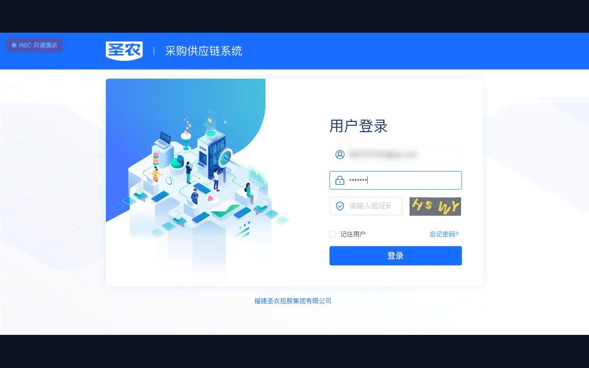
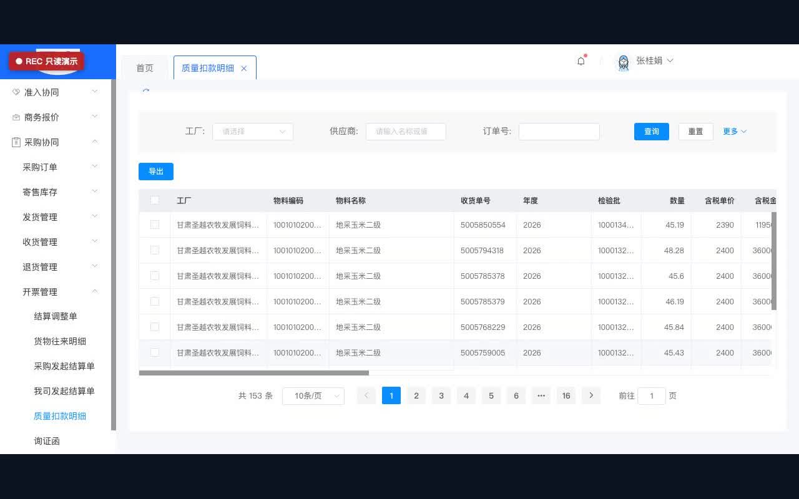
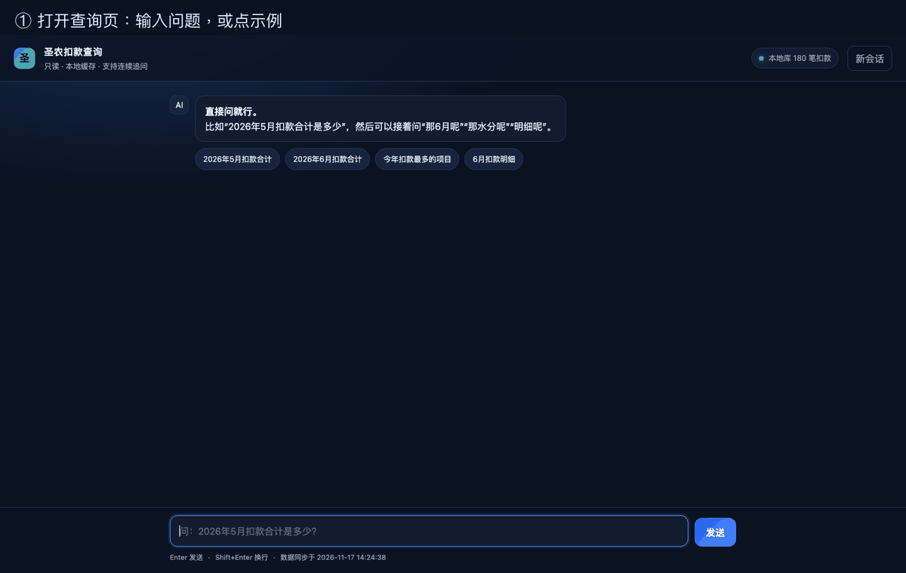
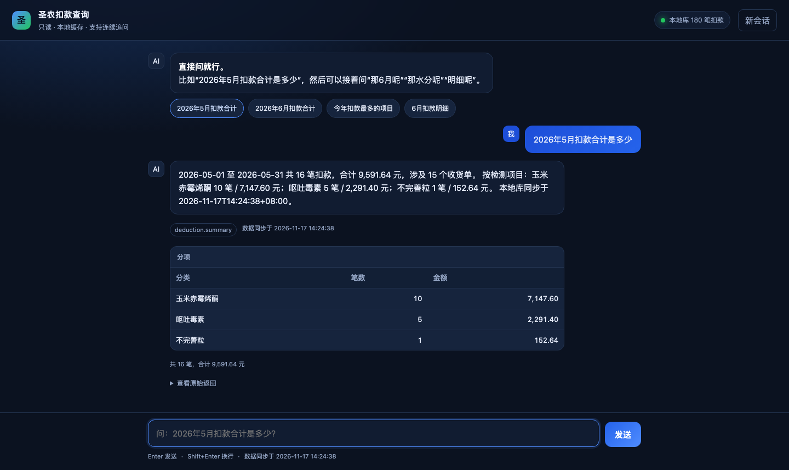
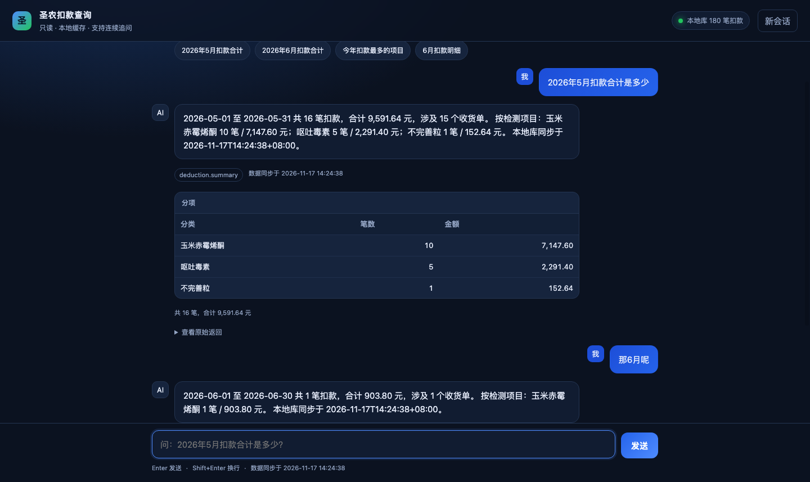
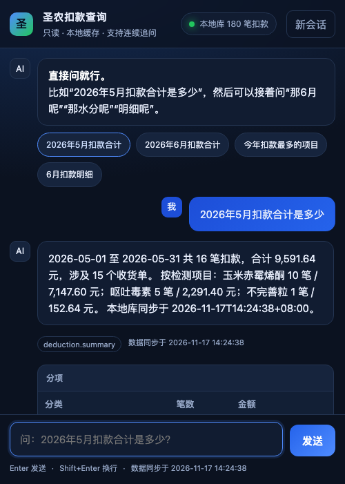

# 演示

## 真实操作录屏（64 秒）

[▶ 查看录屏 demo_live.mp4](docs/demo_live.mp4)

内容：真实登录圣农 SRM（账号打码、密码不显示）→ 进入「采购协同 → 质量扣款明细」→ 翻页读取表格 → 汇总。
页面显示共 153 条 / 16 页；去重后 152 条。




## 查询页 GIF



## 1. 打开页面

地址：`http://127.0.0.1:8790/desk`（本机）  
服务器版：`http://100.65.217.14:8790/desk`（Tailscale 在线时）

首次打开要口令；也可以带 `?k=<QFLOW_TOKEN>` 直接进入。

## 2. 问 5 月



```text
2026-05-01 至 2026-05-31 共 16 笔扣款，合计 9,591.64 元，涉及 15 个收货单。
```

## 3. 直接追问“那6月呢”



```text
2026-06-01 至 2026-06-30 共 1 笔扣款，合计 903.80 元，涉及 1 个收货单。
```

不需要重复说“扣款”“2026 年”，页面会把上一轮的 intent 和参数带下去。

## 4. 手机宽度



## 5. 语音双轮（voicelab）

```text
heard: "2026年5月扣款合计是多少？"
reply: 16 笔 / 9,591.64 元
timings: asr 0.077s / brain 0.010s / total 0.227s

heard: "那6月呢。"
reply: 1 笔 / 903.80 元
timings: asr 0.058s / brain 0.012s / total 0.199s
```

## 6. 自己复现

```bash
cd readflow
python -m qflow serve --host 127.0.0.1 --port 8790 --token "$(cat /tmp/qflow_token)"
open "http://127.0.0.1:8790/desk?k=$(cat /tmp/qflow_token)"
```

数据是 2026-11-17 14:24 的本地快照；页面只读。
