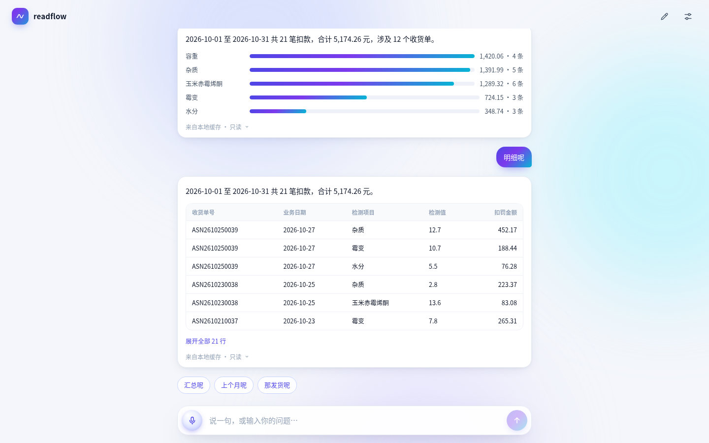

# readflow — 只读业务数据查询层

把「工厂/SRM 系统里只能人工点三级菜单才能看到的数据」变成 voiceAI 可以直接调用的查询接口。

- **只读**：没有保存、提交、审批、发货、删除；代码层面拦截写请求。
- **可离线**：不依赖线上系统，先把导出 Excel 建成 SQLite，马上能问。
- **可接入**：一个 HTTP 接口 + 一份 OpenAI function-calling schema，你的 voiceAI 直接接。
- **探索不在这里做**：系统的页面、接口、数据流由外部大模型探索并产出图谱；本仓库只负责加载图谱、登录接力和只读查询。

## 文档

- [`docs/PLAN.md`](docs/PLAN.md)：现状、数据流、没做的事和顺序。**接手先读这个。**
- [`docs/graph-spec.md`](docs/graph-spec.md)：系统图谱标准 v1（运行层尚未按它实现）。
- [`docs/explorer-brief.md`](docs/explorer-brief.md)：交给外部大模型的探索说明。

## 1. 架构

```
                     ┌──────────────────────────────┐
   voiceAI  ───────► │  POST /query  (只读 HTTP)     │
                     │  intent + params 或自然语言   │
                     └──────────────┬───────────────┘
                                    │
                     ┌──────────────▼───────────────┐
                     │  意图路由 / 轻量中文 NLU      │
                     │  deduction / shipment / ...   │
                     └──────────────┬───────────────┘
                                    │
                     ┌──────────────▼───────────────┐
                     │  SQLite（只读事实表）          │
                     │  shipments / deductions       │
                     └──────────────▲───────────────┘
                                    │ sync
        ┌───────────────────────────┴──────────────────────┐
        │ Excel 导出（deduct.xls / 1000.xls / 3000.xls ...）│
        │ 可选：登录后直连只读接口（QFLOW_LIVE=1）          │
        └──────────────────────────────────────────────────┘
```

设计取舍：**探索/抓取发生在构建时，查询用确定性 SQL 执行**。不把"每一步都让模型看屏幕点按钮"放进运行时，因为那既不便宜也不可靠；模型只在 voiceAI 侧做"听懂问题"，服务端只做参数校验 + SQL + 回答。

### 查询图谱（v0.2）

`graph.json` 是运行时资产，不是文档：

- 节点：`app` / `page` / `api` / `entity` / `provider` / `capability`
- 边：`contains` / `calls` / `returns` / `references` / `derives_from` / `queries`
- 每个 capability 绑定实体和字段（如 `month → biz_date`），并给出 provider 顺序
- capability 还可以带三个可选字段，换系统不用改页面和代码：
  - `examples`：示例问法，页面首页的能力卡片、没听懂时的引导都从这里取
  - `followups`：答完这一问后用户可能接着问什么，随每轮回答一起返回
  - `metrics`：`[{key, label, unit, accent}]`，声明回答里哪些数字值得做成指标卡

```bash
python -m qflow graph                 # 节点/边/覆盖率/在线待接
python -m qflow graph --json          # 原始图
python -m qflow plan "去年11月水分扣了多少"
```

`plan` 输出示例：

```text
意图：deduction.summary（扣款汇总）
实体：扣款明细
过滤：start → biz_date = 2025-11-01，end → biz_date = 2025-11-30，item → item = 水分
路径：provider.cache.deductions（本地缓存·扣款，cache）
  1. 读取本地扣款明细
  2. 按字段过滤：start→biz_date、end→biz_date、item→item
  3. 返回结构化记录
兜底：
  - api.deduction.list：可用
  - page.deduction：未就绪（运行层不做页面读取，只留作结构记录）
```

当前 `graph.json` 是手写的种子：3 个实体、6 个能力、4 个 cache provider，只覆盖扣款、发货和对账。
planner 按 **cache → API → 页面** 的顺序降级。

## 2. 快速开始

```bash
cd readflow
pip install -r requirements.txt       # pandas / openpyxl / xlrd

# 1) 导入上级目录的导出文件（自动跳过 *new.xlsx 合并产物）
python -m qflow sync --dir ..

# 2) 看图 + 看路径 + 直接问
python -m qflow graph
python -m qflow plan "去年11月水分扣了多少"
python -m qflow ask "去年11月扣款合计"
python -m qflow ask "查一下去年11月扣款明细"
python -m qflow ask "2025年11月对账"
python -m qflow ask "查陕KM8696的发货记录"

# 3) 起服务，给 voiceAI / 浏览器用
python -m qflow serve --port 8765
# 浏览器打开：http://127.0.0.1:8765/desk

# 4) 可选：实时模式，登录后直连只读接口（需要 Chrome + ddddocr）
pip install -r requirements-live.txt
SRM_USER=... SRM_PASS=... QFLOW_LIVE=1 python -m qflow serve --port 8765
```

真实输出示例：

```text
$ python -m qflow ask "去年11月扣款合计"
2025-11-01 至 2025-11-30 共 17 笔扣款，合计 13,401.20 元，涉及 16 个收货单。
按检测项目：杂质 8 笔 / 4,828.40 元；水分 7 笔 / 4,552.94 元；
玉米赤霉烯酮 1 笔 / 2,635.84 元；不完善粒 1 笔 / 1,384.02 元。
本地库同步于 2026-11-16T17:22:01+08:00。
```

## 3. 能力清单

| intent | 回答什么问题 | 关键参数 |
|---|---|---|
| `deduction.summary` | 扣了多少钱、哪项扣得多 | month/start/end、item、asn |
| `deduction.detail` | 每笔扣款的单号、日期、检测值、金额 | 同上 + limit |
| `shipment.summary` | 发了多少车/多少吨/多少钱 | month/start/end、plate、group_by |
| `shipment.detail` | 每单的日期、车牌、实收吨数、金额 | 同上 + limit |
| `reconcile` | 发货金额 - 扣款金额 = 净额，异常单 | month/start/end |
| `overview` | 本地有哪些数据、截止到什么时候 | 无 |

`GET /capabilities` 返回完整 JSON Schema；`GET /tools` 直接返回 OpenAI 工具定义。

## 4. HTTP API

默认监听 `127.0.0.1:8765`，只适合本机 voiceAI 调用；要跨机请加 TLS 和防火墙。

| 方法 | 路径 | 说明 |
|---|---|---|
| GET | `/health` | 健康检查（无需鉴权） |
| GET | `/capabilities` | 能力 + 参数 schema + data_as_of |
| GET | `/tools` | OpenAI function-calling schema |
| GET | `/datasets` | 导入审计（文件、行数、状态、时间） |
| GET | `/desk` | 浏览器查询页（问答 + 表格 + 连续追问） |
| POST | `/desk/api/query` | 页面用：`{text, state}` → 多轮回答 |
| POST | `/query` | 查询入口 |
| POST | `/voice/handle` | voicelab `http` brain 适配：`{heard}` → `{reply, handled}` |

鉴权：启动时设置 `--token secret`（或环境变量 `QFLOW_TOKEN`），请求带 `X-API-Key: secret` 或 `Authorization: Bearer secret`。

### 本地模型（可选）

设 `QFLOW_LLM_URL`（OpenAI 兼容的 `chat/completions` 地址，例如 `http://127.0.0.1:8050/v1/chat/completions`）后，规则认不出业务关键词的口语问法（「上个月被罚了多少钱」「这周拉了几车」）会交给本地模型，从图谱的能力里选一类；它还负责认出「想让系统办事」的话并拒绝。模型只答一个字母，时间、条件和所有数字仍由程序处理。不设、连不上或超时（`QFLOW_LLM_TIMEOUT`，默认 3 秒）时只用规则。模型名用 `QFLOW_LLM_MODEL`，默认 `qwen3`。

实测和分工的依据见 [`docs/PLAN.md`](docs/PLAN.md) 第 5 节；重跑：`python scripts/eval_understand.py`。

### 鉴权

设了口令后，除 `/health` 和页面本身外的所有接口都要鉴权，包括 `/desk/api/*`。页面多一种方式：打开 `/desk` 会先要求输入口令，通过后拿到一个当天有效的会话 cookie（只对 `/desk/api/*` 有效）。页面口令默认就是 `QFLOW_TOKEN`；想给人一个好记的口令，另设 `QFLOW_DESK_PASS`，可以是一句中文，比对时忽略空格、标点和全半角。同一来源一天输错 5 次（所有来源合计 30 次）后当天不再受理，重启服务清零。不设 `QFLOW_TOKEN` 时没有任何鉴权，只适合本机开发。

```bash
curl -s http://127.0.0.1:8765/health

curl -s -X POST http://127.0.0.1:8765/query \
  -H 'Content-Type: application/json' \
  -H 'X-API-Key: secret' \
  -d '{"text":"去年11月水分扣了多少"}'

curl -s -X POST http://127.0.0.1:8765/query \
  -H 'Content-Type: application/json' \
  -H 'X-API-Key: secret' \
  -d '{"intent":"deduction.detail","params":{"month":"2025-11","limit":5}}'
```

响应：

```json
{
  "ok": true,
  "intent": "deduction.summary",
  "answer": "2025-11-01 至 2025-11-30 共 7 笔扣款，合计 4,552.94 元……",
  "data": {
    "count": 7,
    "total_amount": 4552.94,
    "asn_count": 7,
    "groups": [{"bucket": "水分", "n": 7, "total": 4552.94}]
  },
  "params": {"start": "2025-11-01", "end": "2025-11-30", "item": "水分"},
  "confidence": 0.9,
  "notes": [],
  "data_as_of": "2026-11-16T17:22:01+08:00",
  "elapsed_ms": 1.8
}
```

`data` 始终保留结构化明细（最多 `limit` 条）；v0.2 起响应还包含 `plan`，说明这次走了哪个实体、哪个 provider、绑定了哪些字段，便于审计和排障。voiceAI 可以直接朗读 `answer`，也可以自己组织话术。

## 5. 接 voiceAI 的两种方式

**方式 A：直接转发自然语言**（最省事）

```json
POST /query
{"text": "<用户原话>"}
```

服务端内置轻量中文解析：本月/上月/去年11月/最近7天、ASN、车牌、水分/杂质等检测项目，以及扣款/发货/对账意图。解析不确定时会返回 `confidence` 和 `notes`，voiceAI 可据此追问。

**方式 B：voiceAI 先做 NLU，再传结构化参数**（最稳）

1. 从 `GET /tools` 取工具 schema；
2. 让模型输出 `{"intent": "...", "params": {...}}`；
3. 原样 POST `/query`。

示例见 [`examples/voiceai_tool_call.json`](examples/voiceai_tool_call.json)。

### 已接 voicelab（2026-11-17）

服务器上的 voiceAI 是 `voicelab`（ASR 8030 / 编排 8040 / Qwen3 8050）。它的
`http` brain 契约是 `POST {heard, context} → {reply, state_patch, handled}`，
readflow 的 `/voice/handle` 已经按这个契约实现，并注册了 agent：

```json
{
  "id": "snxt_deduction",
  "context": "window",
  "speak": false,
  "brain": {"type": "http", "url": "http://127.0.0.1:8790/voice/handle", "timeout": 8}
}
```

实测（真实中文音频）：

```text
2026年5月扣款合计 → 16 笔 / 9,591.64 元，brain 0.17s，总 0.396s
2026年6月扣款合计 → 1 笔 / 903.80 元，brain 0.17s，总 0.377s
```

### 查询页面

服务自带一个单文件页面，不需要单独起前端：

```text
http://<readflow-host>:8790/desk
```

页面平时只有一个会话界面，刻意不展示中间过程：

- **会话**：语音或文字提问；回答只有一句结论、一张图表或明细表，和几个可点的后续问题。
  数据来源和「怎么查的」收在卡片底部一行小字里，点开才显示。页面每轮回传 `state`，所以「那 12 月呢」「明细呢」可以连续追问。
- **管理**（右上角，给部署的人用）：服务和数据现状、分层的节点连线图谱（点节点看字段、取数顺序和示例问法）、
  「导入图谱」把外部探索产出的 JSON 校验后加载到运行层。

> 图谱目前只驱动规划和展示；真正能执行的意图仍是代码里的 6 个。导入含有其它意图的图谱时，页面会标明「只能展示、不能查询」。



支持二次提问：`/voice/handle` 会从 `context.state` 继承上一问的 intent/params。
例如“2026年5月扣款合计” → “那6月呢” → “那水分呢” → “明细呢”。
实测同一 session 两轮：5 月 9,591.64 元 → 6 月 903.80 元，brain 约 0.01s。

`speak: false` 只回文本；要语音播报改成 `speak: true`（TTS 首次自启约 27 秒）。

readflow 已部署在 `juking-super-server` 的 `~/projects/snxt-query`，
systemd user service 常驻，监听 `127.0.0.1:8790`；Mac 上的临时服务已停。
部署步骤见 [`deploy/README.md`](deploy/README.md)。

## 6. 数据口径（重要）

- **biz_date**：扣款取「制单日期」，没有则从 ASN 内嵌日期推断（`ASN2511210602` → 2025-11-21）；发货取「收货日期」，否则「发货日期」，再否则 ASN 日期。
- **订单多行**：同一 ASN 多行会按金额/数量求和，`line_count` 记录行数，不会静默丢数。
- **扣款多笔**：同一 ASN 的水分、杂质等分行保留；`dedup_key` 用 ASN+项目+金额+数量+公式去重，重复导入不会翻倍。
- **`data_as_of` 是本地同步时间**，不是业务数据截止日；业务范围看回答里的日期区间，或 `python -m qflow overview`（等价于 `POST /query {"intent":"overview"}`）。
- 源数据里 `含税金额(必填)`（deduct.xls）看起来是源系统异常值（如 2330000），本服务只展示扣罚金额，不用它计算。
- 合并产物 `1000new.xlsx` / `3000new.xlsx` 会被跳过，避免与原始导出重复计数。

## 7. 实时模式与登录（可选）

`QFLOW_LIVE=1` 时，扣款查询在登录后直连 SRM 的只读列表接口，结果缓存 `QFLOW_LIVE_TTL` 秒；其余能力仍读本地库。

- 账号只从环境变量 `SRM_USER` / `SRM_PASS` 读，不写进代码和图谱；登录会话保存在本机，过期才重新登录。
- 图片验证码先用 ddddocr 自动识别；识别不了时，页面把验证码原图给用户，用户填完再提交回去。
- 发往业务系统的请求先过 [`qflow/online.py`](qflow/online.py) 的只读检查：DELETE/PUT/PATCH 一律拒绝，POST 命中 `save|submit|delete|ship|confirm...` 一律拒绝。

## 8. 定时刷新

查询层不关心数据从哪来，只要文件落到一个目录：

```bash
# 每天 08:00 把新导出文件同步进库（示例，路径按实际改）
0 8 * * * cd /path/to/readflow && python -m qflow sync --dir ~/Downloads >> data/sync.log 2>&1
```

多台机器/多人用时，把 `data/queryflow.db` 放到本地盘即可；不要把登录会话文件
和业务库上传到公共云盘。

## 9. 测试

```bash
python -m pytest tests -q
```

覆盖：日期/ASN 推断、Excel 别名与去重、多行聚合、查询、对账、中文 NLU、HTTP 鉴权与错误码、只读网闸、图谱校验与 planner。

## 10. 目录

```
readflow/
├── qflow/
│   ├── cli.py           # sync / ask / serve / overview / datasets / tools / graph / plan
│   ├── service.py       # 标准库 HTTP 服务
│   ├── web/index.html   # 浏览器会话页（单文件）
│   ├── voice.py         # voicelab http brain 多轮适配
│   ├── nlu.py           # 轻量中文意图/实体/时间解析
│   ├── graph.py         # 查询图谱 + planner
│   ├── capabilities.py  # 能力注册 + voiceAI 工具 schema
│   ├── engine.py        # SQL 查询与对账
│   ├── answer.py        # 中文回答渲染
│   ├── importer.py      # Excel -> SQLite（去重/聚合/审计）
│   ├── db.py / dates.py # SQLite schema；ASN 日期推断、区间解析
│   ├── livequery.py     # 实时模式：登录后直连只读接口
│   ├── srm.py / srmlogin.py / srmapi.py  # SRM 登录、验证码、会话、接口
│   ├── authbridge.py / systems.py        # 验证码接力；已接入系统清单
│   └── online.py        # 只读检查
├── graph.json           # 运行层加载的图谱
├── systems/             # 已接入系统的描述
├── data/explore/        # 外部探索产出（结构图，尚未接入运行层）
├── tests/
├── deploy/              # 服务器部署 unit 与步骤
├── docs/desk.png        # 页面截图
├── examples/            # voiceAI 调用示例
└── data/                # queryflow.db（gitignore）
```

## 11. 已知限制 / 下一步

- **不是实时数据**：查询的是本地缓存，需要定时 `sync` 或后续的在线 `refresh`。
- **图谱目前是种子**：只覆盖扣款、发货、对账；`data/explore/` 里的探索结果只有结构（模块、菜单、页面、接口），还没有字段和能力，没有接入运行层。
- **实时模式只支持扣款**。
- **NLU 是兜底**：复杂问法（多条件、跨表）建议由 voiceAI 产出结构化 `intent + params`。
- **无写操作**：这是刻意的；查询层不应具备发货/审批能力。
- 后续：定图谱标准、按图谱通用取数、按用户隔离账号与会话。
